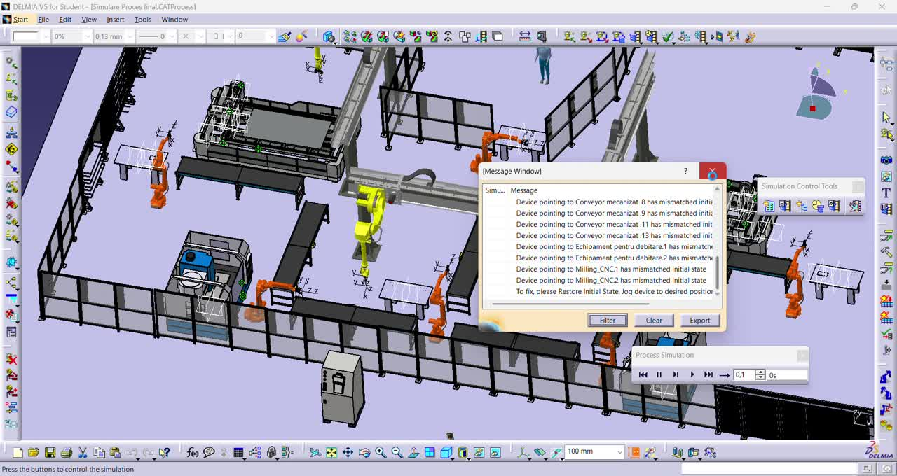

# CATIA / DELMIA | Digital Production Process Simulation

**Simulation of an automated manufacturing cell using industrial robots, conveyors, machining stations, and robotic welding**  
University project · Digital Production · CATIA / DELMIA · 2026  
**Author:** Mihai-Cezar Moldovan



## Overview

A **digital manufacturing-process simulation** developed in **CATIA / DELMIA V5**, representing a production cell for a **kunai-shaped metal component**. The modeled workflow combines parallel material preparation, robotic part handling, CNC machining, welding/assembly, and final inspection.

The objective was to organize and simulate a coordinated industrial production process, focusing on **resource layout**, **operation sequencing**, **material transfer**, **robotic handling**, and **process visualization**. This is a virtual manufacturing simulation; it does not claim physical implementation or production validation.

> **Project demonstration:** [Watch the simulation recording](catia-production-demo.mp4)  
> **Simulation files:** The complete CATIA/DELMIA archive is distributed separately because the project includes hundreds of linked CAD dependencies.

## Key features

- **Manufacturing-cell layout:** Integrated robotic workstations, conveyors, machining equipment, welding resources, safety fencing, and operators.
- **Robotic material handling:** Six ABB IRB 2600ID handling robots, described in the course presentation, for transfers and machine loading/unloading.
- **Additional robot stations:** Three Fanuc-series robots assigned to welding and pick-and-place operations in the presented design.
- **Parallel processing:** Separate preparation and laser-cutting paths for the blade and grip components.
- **Machining operations:** Simulated CNC finishing stages for both components.
- **Robotic assembly:** Part positioning and predefined welding toolpath operations in a shared assembly area.
- **Process visualization:** Recorded DELMIA simulation demonstrating the overall production-cell arrangement and activity.

## Hardware and software represented

| Area | Resources / tools |
| --- | --- |
| Digital manufacturing platform | CATIA / DELMIA V5 |
| Robotic handling | ABB IRB 2600ID robots with vacuum grippers |
| Welding and transfer | Fanuc-series robots with welding and handling end-effectors |
| Production transport | Conveyors and intermediate workstations |
| Processing equipment | Two laser-cutting lines and CNC machining stations |
| Other resources | Operators, fencing, control points, and assembly fixtures |
| Project deliverables | `.CATProcess`, `.CATProduct`, `.CATPart`, simulation video, presentation |

The robot assignments and operations above describe the **planned and presented simulated system**, not measured manufacturing performance.

## Production process

```text
Operator starts the simulated production sequence
                   ↓
Parallel preparation and laser cutting
     ├── Blade component
     └── Grip component
                   ↓
Robotic transfer via conveyors
                   ↓
CNC machining and finishing
                   ↓
Robotic positioning and welding/assembly
                   ↓
Final inspection and output station
```

### 1. Parallel cutting and part preparation

Two component streams prepare the blade and grip geometries. Robots transfer the processed parts from the cutting stations onto conveyors for subsequent operations.

### 2. CNC machining and material transport

Conveyors and handling robots connect the cutting workstations to the CNC machines. The presentation describes edge machining, surface finishing, and contour refinement as planned process operations.

### 3. Robotic welding and assembly

Robotic handling positions the components at the welding workstation, where a predefined tool-center-point trajectory represents the assembly operation.

### 4. Inspection and output

The production flow concludes at an operator inspection and output area, with visual and dimensional quality checks described in the project presentation.

## Simulation screenshots

### Production-cell layout


## Demonstration video

The following video records the modeled production environment and the DELMIA process simulation.

**

https://github.com/user-attachments/assets/f1901ba2-88e9-4c96-9792-453b381a1657

**

## Project files

The original CATIA archive contains the complete process and its referenced parts, assemblies, and equipment models. In particular, it includes:

- `Simulare Proces final.CATProcess` — final simulation process.
- `Layout varianta 1.CATProcess` and other intermediate layout/process versions.
- Linked `.CATProduct` and `.CATPart` models for resources, conveyors, workstations, tools, and workpieces.

**Important:** Keep the original folder hierarchy when extracting the complete source archive. The `.CATProcess` file may reference many other files, so publishing only the process file is unlikely to provide a working standalone project.

The **complete CATIA source archive** is intentionally not included in this lightweight repository: the supplied archive exceeds 100 MB and includes referenced equipment models that may have third-party usage restrictions. It can be shared separately where rights permit.

## Repository structure

```text
catia-production-simulation/
├── README.md
├── images/
│   ├── production-cell-overview.jpg
│   └── production-process.jpg
└── catia-production-demo.mp4
```

## Development scope and limitations

The project demonstrates **virtual production planning and process simulation**, not a deployed industrial system. Robot paths, cycle times, collision clearance, workcell throughput, safety integration, and finished-product quality would require additional engineering validation before physical deployment.

The project presentation describes a planned process sequence. It does not provide independently validated cycle-time or throughput measurements, so no such performance claims are made here.

## Academic context

Completed as a university **Digital Production** project by **Mihai-Cezar Moldovan**. The accompanying presentation documents the cell layout, robot assignments, parallel cutting, CNC operations, robotic welding, and final handling stages.
